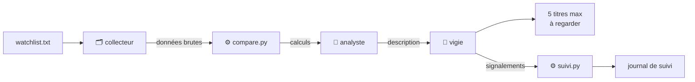

<div align="center">

# 🔭 vigie-options

**Trois agents Claude Code qui repèrent chaque jour une activité inhabituelle sur les options de ta watchlist, et qui ne te disent jamais quoi acheter.**

[](https://github.com/Amine-Senhadji/vigie-options/actions/workflows/tests.yml)


[](LICENSE)

[English version](README.en.md) · [Architecture](docs/architecture.md) · [Méthodologie](docs/methodologie.md) · [Exemple de sortie](exemples/vigie-exemple.md)

</div>

---

```text
> /bourse

  collecteur  ✓ 3 tickers, séance du 30/09, aucune donnée manquante
  analyste    ✓ historique correct (21 séances), 1 signalement
  vigie       ✓

  1. GLOBEX – confiance faible
     Volume d'options : 10 780 contrats (médiane 410, 100e centile de son historique)
     Open interest : +3 025 calls, +3 004 puts → nouvelles positions ouvertes
     Cours : inchangé
     Explication banale probable : résultats le 20/10, calls et puts montent ensemble
     À vérifier : bloc unique ou ordres multiples ? le secteur a-t-il bougé ?
```
<sub>Sortie fictive, sur données simulées. Exemple complet : [exemples/vigie-exemple.md](exemples/vigie-exemple.md).</sub>

## Pourquoi ce projet

Le volume d'options est l'un des rares endroits où une activité importante devient visible avant de se voir sur le cours. C'est aussi l'un des plus faciles à surinterpréter : chaque contrat a un acheteur et un vendeur, et la même activité peut être un pari, une prime encaissée ou une couverture.

`vigie-options` est conçu autour de ce piège :

- 🧮 **Les chiffres sont calculés en Python, testés, jamais de tête.** Les agents décrivent un fichier de calculs, ils ne le produisent pas.
- 🔍 **L'open interest est comparé contrat par contrat, sur les contrats où le volume s'est concentré**, pour distinguer les positions ouvertes des positions fermées. Un open interest figé ou en retard d'une séance est détecté.
- 📏 **L'inhabituel se mesure contre l'historique propre de chaque titre**, pas en valeur absolue.
- 🚫 **Aucune recommandation, aucun « haussier » ni « baissier ».** Une activité est décrite comme une activité, avec d'abord son explication la plus banale.
- 🕳️ **Aucun trou comblé.** Une donnée manquante reste `INDISPONIBLE`.
- 📒 **Un journal de suivi tenu par Python**, complété automatiquement à J+14 et comparé à des témoins, pour mesurer au bout de quelques mois ce que valent vraiment les signalements.

## Comment ça marche



| Agent | Son seul travail | Ce qu'il n'a pas le droit de faire |
|---|---|---|
| **collecteur** | Récupérer cours, chaîne d'options, open interest et événements à venir | Analyser, estimer une donnée manquante |
| **analyste** | Décrire l'activité par rapport à l'historique du titre | Recommander, qualifier une activité de haussière ou baissière |
| **vigie** | Sortir au plus 5 titres à regarder, avec l'explication banale la plus probable | Recommander une entrée, une sortie ou une taille de position |

Détails : [architecture](docs/architecture.md) et [méthodologie](docs/methodologie.md).

## Installation

Prérequis : Python 3.10 ou plus récent, et [Claude Code](https://docs.claude.com/en/docs/claude-code/overview) avec un abonnement Claude Pro ou Max.

```bash
git clone https://github.com/Amine-Senhadji/vigie-options.git
cd vigie-options
python3 -m venv .venv
.venv/bin/pip install -r requirements.txt
```

Sous Windows, remplace `.venv/bin/` par `.venv\Scripts\` (ou utilise WSL).

Mets ensuite tes tickers dans `watchlist.txt`, un par ligne, avec leur code Yahoo Finance (`AAPL`, `MSFT`…). Seules les valeurs avec des options listées donnent des résultats, en pratique surtout les actions américaines.

## Utilisation

```bash
claude
> /bourse
```

| Fichier produit | Contenu |
|---|---|
| `donnees/brut-AAAA-MM-JJ.json` | Données brutes, avec source et horodatage |
| `donnees/comparaison-AAAA-MM-JJ.json` | Rangs, moyennes, variation d'open interest contrat par contrat |
| `rapports/analyse-AAAA-MM-JJ.md` | Description de l'analyste |
| `rapports/vigie-AAAA-MM-JJ.md` | Liste de recherche du jour |
| `rapports/signalements-AAAA-MM-JJ.json` | Signalements de la vigie, lus par `suivi.py` |
| `suivi/journal.csv` | Un signalement par ligne, cours à J+14 et témoins complétés automatiquement |

Ces dossiers sont exclus de Git : tes données et ta watchlist de travail restent chez toi.

### Quand le lancer

Le matin, avant l'ouverture américaine (15 h 30, heure de Paris). Le volume est alors celui de la séance de la veille et l'open interest a été mis à jour pendant la nuit. Lance-le à la même heure chaque jour.

Pendant la séance américaine, `collect.py` refuse de collecter : les volumes seraient partiels. Un jour férié aux États-Unis, que le script ne connaît pas, relance avec `--forcer`. Le fichier est alors exclu de l'historique.

### Le premier mois

yfinance ne fournit aucun historique d'options : le projet construit le sien, une collecte par jour.

| Séances collectées | Ce que tu obtiens |
|---|---|
| 1 | Données brutes uniquement |
| 2 à 9 | Variation d'open interest, mais aucun volume qualifié d'inhabituel |
| 10 à 19 | Signalements possibles, confiance plafonnée à « faible » |
| 20 et plus | Comparaisons complètes |

Pour ne perdre aucune séance, automatise la seule collecte (sans Claude) avec cron :

```cron
0 9 * * 1-5 cd /chemin/vers/vigie-options && .venv/bin/python scripts/collect.py >> donnees/cron.log 2>&1
```

### Mesurer ce que valent les signalements

```bash
.venv/bin/python scripts/suivi.py bilan
```

Le bilan compare le mouvement absolu des titres signalés à J+14 à celui des autres titres de ta watchlist sur la même période. Il ne dit rien de la direction et ne conclut pas en dessous de 30 signalements. La colonne `ce_qui_s_est_passe` du journal est à remplir à la main. Détails : [méthodologie](docs/methodologie.md#9-le-journal-de-suivi).

### Régler les critères

Les seuils sont en haut de [`scripts/compare.py`](scripts/compare.py) et expliqués dans la [méthodologie](docs/methodologie.md). L'horizon des échéances suivies se règle avec `scripts/collect.py --horizon 60`.

## Structure du dépôt

```text
vigie-options/
├── .claude/
│   ├── agents/          collecteur.md · analyste.md · vigie.md
│   └── commands/        bourse.md  →  la commande /bourse
├── scripts/
│   ├── collect.py       collecte Yahoo Finance (yfinance)
│   ├── compare.py       calculs de comparaison
│   └── suivi.py         journal de suivi et bilan
├── tests/               tests sur données simulées, sans réseau
├── docs/                architecture · méthodologie
├── exemples/            exemple de sortie de la vigie
├── CLAUDE.md            règles communes aux agents
└── watchlist.txt        tes tickers
```

## Tests

```bash
.venv/bin/pip install -r requirements-dev.txt
.venv/bin/pytest
```

Les tests simulent Yahoo Finance. Ils vérifient notamment :

- qu'un choc de volume avec ouverture de positions est signalé, et qu'un fort mouvement du cours l'écarte ;
- qu'une hausse d'open interest hors des contrats les plus échangés ne suffit pas ;
- qu'un open interest figé ou en retard d'une séance est détecté ;
- qu'un historique trop court n'est jamais qualifié, qu'un week-end n'est pas compté comme une séance, et qu'une collecte pendant la séance est exclue ;
- que le journal refuse un ticker inventé, ne double aucune ligne et se complète à J+14 avec ses témoins.

La CI les exécute sur Python 3.10, 3.11 et 3.12 à chaque push.

## Limites

- **Le volume d'options ne donne pas la direction.** C'est un filtre d'attention, pas une fenêtre sur « l'argent intelligent ».
- **Les données gratuites sont en différé et parfois fausses.** yfinance est une source non officielle, réservée à un usage personnel, qui peut casser sans prévenir. En cas d'erreur : `.venv/bin/pip install -U yfinance`.
- **L'open interest de Yahoo est souvent en retard d'une séance.** Le décalage est détecté quand il est net, pas corrigé.
- **Les jours fériés américains ne sont pas connus** de `collect.py` (voir `--forcer`).
- **Un signalement est le début d'une recherche, pas une décision.**

  ## Contribuer

Les retours sont les bienvenus, surtout sur la méthodologie et les cas où un signalement t'a paru absurde.

- **Un bug ou une donnée bizarre ?** Ouvre une [issue](https://github.com/Amine-Senhadji/vigie-options/issues) avec la commande lancée, la date et, si possible, le fichier `donnees/comparaison-AAAA-MM-JJ.json` concerné (sans ta watchlist si tu préfères la garder pour toi).
- **Une amélioration ?** Ouvre une pull request depuis une branche dédiée. Avant de l'envoyer, vérifie que les tests passent :

```bash
  .venv/bin/pip install -r requirements-dev.txt
  .venv/bin/pytest
```

- **Une règle des agents à modifier ?** Explique dans la pull request quel piège elle évite ou quel cas elle couvre : chaque règle de `CLAUDE.md` et de `.claude/agents/` existe pour une raison.

Aucune contribution ne doit ajouter de recommandation d'achat ou de vente, ni qualifier une activité de haussière ou baissière.

## Crédits

Adapté du système en trois agents décrit par Ray Fu, dans sa version française publiée par [Core Labs](https://corelabs.studio). Cette implémentation ajoute le calcul déterministe des comparaisons, le suivi de l'open interest contrat par contrat, les contrôles de qualité, la gestion de l'historique, le journal de suivi avec témoins et les tests.

Historique des versions : [CHANGELOG](CHANGELOG.md).

## Avertissement

Ce projet est un outil de recherche personnel. **Rien ici n'est un conseil en investissement.** Les options comportent un effet de levier et une date d'expiration : on peut avoir raison sur la direction et tout perdre sur le timing. N'investis jamais un argent que tu ne peux pas te permettre de perdre.

## Licence

[MIT](LICENSE)
