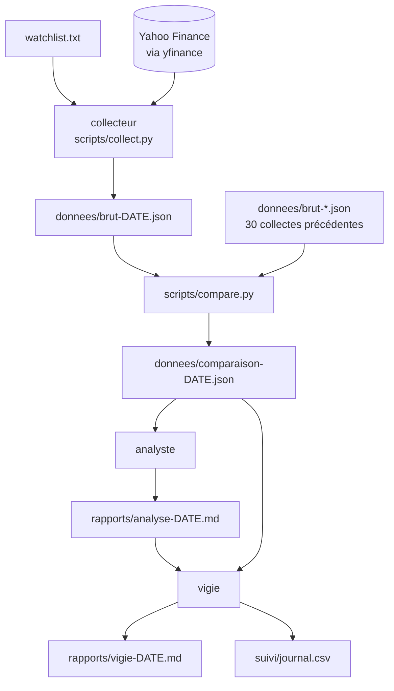

# Architecture

## Principe : séparer ce qui calcule de ce qui raconte

Un modèle de langage est bon pour décrire et contextualiser, médiocre pour faire des calculs fiables sur des centaines de chiffres, et naturellement porté à construire des récits convaincants. Le projet en tient compte :

| Couche | Rôle | Déterministe ? |
|---|---|---|
| `scripts/collect.py` | Récupère les données brutes | Oui (Python) |
| `scripts/compare.py` | Calcule toutes les comparaisons | Oui (Python, testé) |
| Agent `collecteur` | Lance la collecte, rapporte les trous | Non, mais sans marge d'interprétation |
| Agent `analyste` | Décrit les chiffres du fichier de comparaison | Non |
| Agent `vigie` | Hiérarchise, cherche l'explication banale | Non |

Chaque agent n'a accès qu'aux outils dont il a besoin : la vigie ne peut exécuter aucune commande, le collecteur ne peut écrire aucun fichier.

## Flux



## Fichiers produits

### `donnees/brut-AAAA-MM-JJ.json`

```text
date_collecte, source, horodatage_debut, horodatage_fin, horizon_echeances_jours
tickers.<TICKER>
  cours        date_seance, cloture, volume, variation_pct, volume_moyen_30_seances,
               ratio_volume_vs_moyenne_30, historique_90j[], source, horodatage
  options      echeances_retenues[], echeances_en_echec[], volume_calls, volume_puts,
               open_interest_calls, open_interest_puts, contrats_sans_volume,
               contrats[] (symbole, type, echeance, strike, volume, open_interest, dernier_echange)
  evenements   evenements[] (type, date), calendrier_brut, source, horodatage
```

Toute valeur manquante vaut la chaîne `"INDISPONIBLE"`. Un bloc entièrement manquant porte `"statut": "INDISPONIBLE"` et, si possible, `"erreur"`.

### `donnees/comparaison-AAAA-MM-JJ.json`

```text
date, fichier_jour, fichier_veille, criteres_candidat
tickers.<TICKER>
  date_seance, fiabilite_historique, candidat, avertissements[], evenements_30j
  cours            variation_pct, ecart_type_variations_30j_pct, z_score_mouvement,
                   ratio_volume_action_vs_moyenne_30
  volume_options   jour, calls, puts, nb_jours, min, max, moyenne, mediane, rang_percentile, z_score
  ratio_calls_puts jour, nb_jours, min, max, moyenne, mediane, rang_percentile, z_score
  open_interest    contrats_compares, contrats_absents_la_veille, delta_total_calls, delta_total_puts,
                   strikes_les_plus_actifs[], plus_fortes_variations_oi[]
                   (ou statut si la variation n'est pas mesurable)
```

## Pourquoi construire son propre historique

yfinance ne donne que la chaîne d'options du moment : pas d'historique de volume ni d'open interest. Chaque collecte quotidienne est donc conservée, et `compare.py` relit les 30 précédentes. Une conséquence directe : le système devient utile au bout de 10 séances, et fiable au bout de 20 (voir [méthodologie](methodologie.md)).
